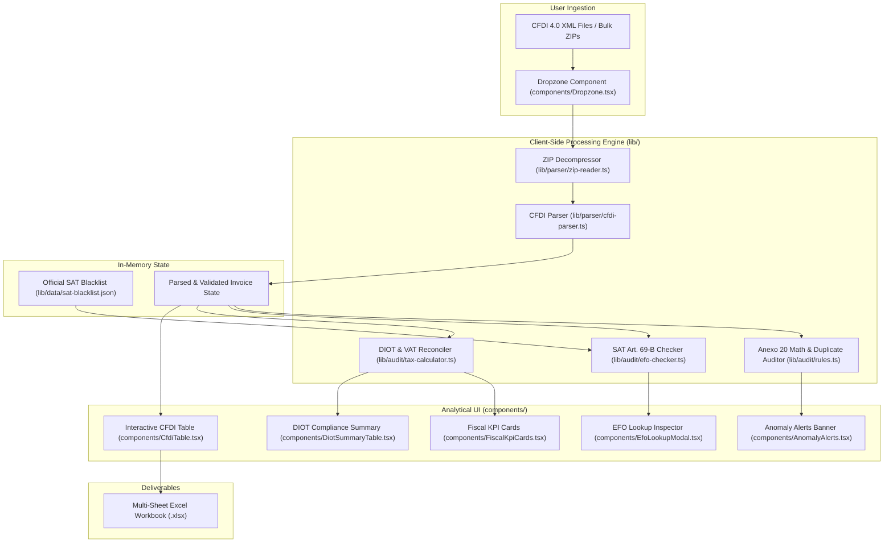
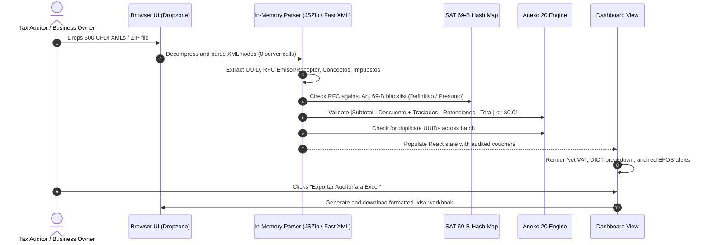

# 🏛️ CFDI Sentinel Architecture & System Topology

Privacy-first, client-side fiscal auditing web application and SAT Article 69-B (EFOS) blacklist sentinel for Mexican CFDI 4.0 XML invoices and bulk ZIP files. Built with Next.js 15, TypeScript, Tailwind CSS, Fast XML Parser, SheetJS, and Vitest.

---

## 1. Technology Stack

| Layer | Technology | Details |
| :--- | :--- | :--- |
| **Framework** | Next.js 15 (App Router) & React 19 | Client-rendered privacy-first architecture (zero server telemetry) |
| **Language** | TypeScript 5 (Strict Mode) | Full type definitions for CFDI 4.0 vouchers, taxes, and EFOS states |
| **Parsing Engine** | `fast-xml-parser` & `jszip` | In-memory XML traversal, namespace handling, and chunked ZIP decompression |
| **Regulatory Engine** | SAT Art. 69-B / Anexo 20 | O(1) hash cross-referencing against official SAT blacklists and tax math rules |
| **Export & Reporting**| SheetJS (`xlsx`) | Formatted multi-tab Excel workbooks (audit trail, DIOT, EFOS alerts) |
| **Testing** | Vitest | Unit tests covering Anexo 20 tolerance limits, tax math, and EFO detection |

---

## 2. System Topology & Component Graph



---

## 3. Data Processing Lifecycle



---

## 4. Directory Structure & Module Breakdown

```
cfdi-sentinel/
├── app/                      # Next.js App Router entrypoints
│   ├── globals.css           # Tailwind CSS styles and custom UI tokens
│   ├── layout.tsx            # Root layout and metadata
│   └── page.tsx              # Main dashboard compiling Dropzone, KPIs, and Tables
├── components/               # React UI components
│   ├── Dropzone.tsx          # Drag-and-drop XML/ZIP file ingestion
│   ├── FiscalKpiCards.tsx    # Total revenue, expenses, Net VAT, and risk counters
│   ├── AnomalyAlerts.tsx     # Color-coded banners for tax drift and blacklisted suppliers
│   ├── CfdiTable.tsx         # Filterable, sortable table of all processed invoices
│   ├── DiotSummaryTable.tsx  # Taxpayer DIOT VAT rate breakdown (16%, 8%, 0%, Exento)
│   ├── EfoLookupModal.tsx    # Modal to inspect legal status of flagged suppliers
│   └── Header.tsx            # Top branding and status bar
├── lib/                      # Core business and domain logic
│   ├── parser/               # XML and ZIP file decoders
│   │   ├── cfdi-parser.ts    # CFDI 4.0 schema parser, namespace handling, dates
│   │   └── zip-reader.ts     # In-memory ZIP archive decompression
│   ├── audit/                # Regulatory and algorithmic rules
│   │   ├── efo-checker.ts    # O(1) RFC lookup against SAT Art. 69-B records
│   │   ├── rules.ts          # Anexo 20 arithmetic tolerance, duplicate UUID detection
│   │   └── tax-calculator.ts # VAT transfer/withholding reconciliation & DIOT formulas
│   ├── export/               # Workbook builders
│   │   └── excel-exporter.ts # SheetJS multi-tab Excel workbook generator
│   ├── data/                 # Datasets
│   │   └── sat-blacklist.json# Offline snapshot of official SAT EFOS list
│   └── types.ts              # Strict TypeScript definitions
├── tests/                    # Vitest unit test suite
│   ├── audit-rules.test.ts   # Anexo 20 tolerance and duplication tests
│   ├── cfdi-parser.test.ts   # Node extraction and date parsing assertions
│   └── tax-calculator.test.ts# DIOT aggregation and VAT calculation tests
├── vitest.config.ts          # Vitest testing configuration
└── package.json              # Project dependencies and scripts
```
